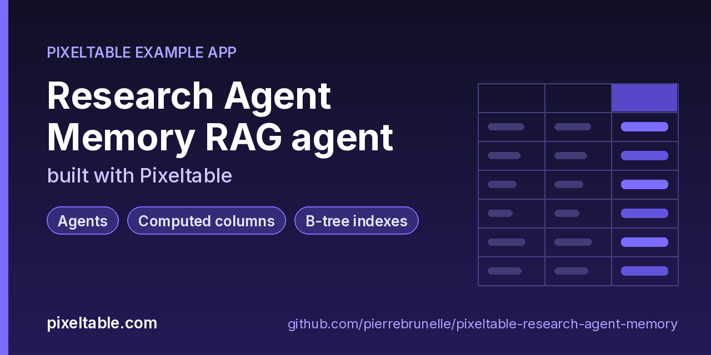

<!-- pixeltable-example-app: 20261015-research-agent-memory -->
# Build durable multimodal memory for AI agents in Python

**Short answer:** keep the agent's memory in Pixeltable tables. Each memory is a row (fact, preference, episode or summary) with an embedding index on its text, so recall is a `@pxt.query` with `.similarity()` scoped to one user. The agent itself is a table of turns whose computed columns recall memories, call the LLM with tools and propose a memory to write back. Everything is stored, versioned and incremental, and the same `app.py` runs locally or on Pixeltable Cloud; there is no separate vector database, cache or job queue.

**Replaces:** Mem0 / Redis + Postgres + a vector DB

**Use case:** [pixeltable.com/learn/what-is-agent-memory](https://pixeltable.com/learn/what-is-agent-memory)



[](https://codespaces.new/pierrebrunelle/pixeltable-research-agent-memory?quickstart=1)
[](https://pixeltable.com)
[](https://pypi.org/project/pixeltable/)
[](https://github.com/pixeltable/pixeltable)
[](LICENSE)

A research assistant that remembers. `Sources` holds the papers and notes it has read (with an optional cover image). `Memories` holds per-user facts, preferences, episodes and consolidated summaries, embedded with OpenAI `text-embedding-3-small` into an `EmbeddingIndex` plus a B-tree on `user_id`. `recall_memories` is semantic recall scoped to one user, `lookup_source` is an exact-key lookup the LLM can call as a tool, and `Turns` is the agent table: recall, `gpt-4o-mini` with tools, `invoke_tools`, a final answer and a rule-based memory write-back. `run.py` also builds `pxt.retrieval_udf` lookups on the live tables (enrichment and an LLM tool) and consolidates memory with two `@pxt.uda` aggregates: `salience` (recency-decayed importance) and `memory_digest` (counts per kind + top memories), whose output is written back as a summary memory. `upgrade_check.py` snapshots counts and recall before a `pip install -U pixeltable` and verifies them after. Drive it with `python run.py`; no HTTP router.

[Pixeltable](https://pixeltable.com) is open-source, Python-native **multimodal AI data infrastructure**: tables, incremental computed columns, UDFs, indexes and serving in one library, running locally or on Pixeltable Cloud.

> ⭐ **Like this example?** Star [pixeltable/pixeltable](https://github.com/pixeltable/pixeltable) on GitHub. It helps other developers find it.

## What this example shows

- **Incremental computed columns** powered by plain Python UDFs (`@pxt.udf`)
- **B-tree indexes** declared on the model (`__indexes__`) back the lookup queries
- **Multimodal media columns** with configurable media destinations
- **Agents and tool calling**: Pixeltable functions exposed as LLM tools
- **Importable UDF module**: UDFs live in `udfs.py`; tables and queries live in `app.py` (Pixeltable resolves UDFs by module path)
- **`pixeltable.toml`** declares a local database and a **Pixeltable Cloud** database, so the same code deploys with `pxt db update`

## Memory model

| Table | Role |
|---|---|
| `Sources` | Papers, pages and notes the assistant has read; `cover` is an optional `pxt.Image` |
| `Memories` | One fact / preference / episode / summary per row and user, with an embedding index on `content` and a B-tree on `user_id` |
| `Turns` | The agent: message → recalled memories → LLM with tools → answer → proposed memory |

Recall is scoped per user: `Memories.where(Memories.user_id == user_id).order_by(content.similarity(string=context), asc=False).limit(k)`. Pick `k` instead of a fixed similarity cut-off: with `text-embedding-3-small`, relevant memories often score between 0.4 and 0.6.

## Write-back and consolidation

`Turns.remember` turns "remember that ..." and "I prefer ..." messages into a proposed memory; `run.py` inserts it into `Memories`, where it is embedded on insert and recallable on the next turn. Consolidation uses two `@pxt.uda` aggregates from `udfs.py` in a `group_by(user_id)` query: `salience(importance, created_at, half_life_days=30)` sums importance with exponential recency decay, and `memory_digest(kind, content, importance, created_at)` returns counts per kind plus the top memories. `digest_text(memory_digest(...))` becomes a `summary` memory per user.

## Retrieval UDFs

`pxt.retrieval_udf(table, parameters=[...], limit=...)` turns a table into a keyed lookup function. It takes a live table, so `run.py` builds it from `pxt.get_table(...)` after `pxt schema update`: `get_source(source_id=...)` enriches memories with their source, `memories_of_kind(user_id=..., kind=...)` lists memories by kind, and `pxt.tools(get_source, reading_tier)` hands the lookup to the LLM in an ad-hoc query. Inside `app.py` the same lookup is a `@pxt.query` (`lookup_source`), which works directly on the model classes.

## Tool calling

`TOOLS = pxt.tools(lookup_source, reading_tier)` mixes a `@pxt.query` and a `@pxt.udf`. `Turns.response` calls `openai.chat_completions(..., tools=TOOLS)`, `invoke_tools` runs whatever the model chose, and a second call writes the final answer when a tool ran. Keep at least one `@pxt.udf` in a toolset: on pixeltable 0.7.16 a toolset made only of `@pxt.query` tools makes `invoke_tools` wait forever on a response with no tool calls.

## Upgrading Pixeltable

```bash
python upgrade_check.py snapshot
pip install -U 'pixeltable[serve]'
pxt schema diff app.py research     # expect: 3 unchanged, 0 destructive
python upgrade_check.py verify      # same counts, same top recall, new writes still embedded
```

This app was checked from pixeltable 0.7.15 to 0.7.16 this way: same row counts and table versions, identical recall, no schema changes.

## What's inside

| File | What it is |
|------|------------|
| `.devcontainer/devcontainer.json` | GitHub Codespaces / Dev Container config: Python 3.12, installs `requirements.txt` |
| `.github/social-preview.png` | Social preview image (1280x640) |
| `CITATION.cff` | Citation metadata (authors, license, release date, keywords) |
| `app.py` | Tables declared as Python classes and `@pxt.query` functions |
| `data/cover_S-01.png` | Sample data |
| `data/cover_S-02.png` | Sample data |
| `data/cover_S-03.png` | Sample data |
| `data/cover_S-04.png` | Sample data |
| `data/memories.json` | Sample data |
| `data/sources.json` | Sample data |
| `pixeltable.toml` | Project config: the local database plus a Pixeltable Cloud database (sizing, deploy excludes) |
| `run.py` | Research Agent Memory driver (rag-agent shape, no HTTP router) |
| `udfs.py` | Pixeltable UDFs (`@pxt.udf`) in their own importable module, imported by `app.py` |
| `upgrade_check.py` | Check that the agent's memory survives a Pixeltable upgrade |
| `requirements.txt` / `pyproject.toml` | Dependencies (`pixeltable>=0.7.16`) |

**Tables**

| Table | Stored columns | Computed columns |
|-------|---------|------------------|
| `sources` | `source_id`, `title`, `kind`, `year`, `url`, `cover` | - |
| `memories` | `user_id`, `kind`, `content`, `importance`, `created_at`, `source_id` | `memory_id` |
| `turns` | `user_id`, `message` | `turn_id`, `recalled`, `memory_text`, `response`, `tool_output`, `final`, `answer`, `remember` |

## Run in your browser (GitHub Codespaces)

[](https://codespaces.new/pierrebrunelle/pixeltable-research-agent-memory?quickstart=1)

1. Click **Open in GitHub Codespaces** above (or [this link](https://codespaces.new/pierrebrunelle/pixeltable-research-agent-memory?quickstart=1)). The dev container installs Python 3.12 and `pixeltable>=0.7.16` from `requirements.txt`.
2. In the codespace terminal, create the tables, seed them and run the app:

   ```bash
   pxt schema update app.py research
   export OPENAI_API_KEY=...   # embeddings + a few gpt-4o-mini calls (3 agent turns)
   python run.py
   python upgrade_check.py snapshot   # before upgrading Pixeltable; then: python upgrade_check.py verify
   ```


## Quickstart

Requires Python 3.11+ and `pixeltable>=0.7.16`.

```bash
git clone https://github.com/pierrebrunelle/pixeltable-research-agent-memory.git
cd pixeltable-research-agent-memory
python -m venv .venv && source .venv/bin/activate
pip install -r requirements.txt

# Create the tables in a local catalog directory named `research`
pxt schema update app.py research

export OPENAI_API_KEY=...   # embeddings + a few gpt-4o-mini calls (3 agent turns)
python run.py
python upgrade_check.py snapshot   # before upgrading Pixeltable; then: python upgrade_check.py verify
```

## Deploy to Pixeltable Cloud

The same `app.py` runs on [Pixeltable Cloud](https://pixeltable.com). Sign in (or get a free trial database with `pxt new`), point the second database entry in `pixeltable.toml` at your own database, then deploy:

```bash
pxt login                       # or: export PIXELTABLE_API_KEY=<your-api-key>
# edit pixeltable.toml: name = 'pxt://<your-org>:<your-db>'
pxt db update pxt://<your-org>:<your-db>                 # build the image and upload the project
pxt schema update app.py pxt://<your-org>:<your-db>/research   # create the tables in the hosted database
```

Keep keys in environment variables or `pxt secret set`, never in code.

## Code walkthrough

**1. Business logic is plain Python, in `udfs.py`.** A `@pxt.udf` function can be used as a column expression. Pixeltable records UDFs by module path (`udfs.extract_memory`), so they live in their own importable module rather than inline in the app: the daemon, serving workers and Pixeltable Cloud import it again by that path.

```python
# udfs.py
@pxt.udf
def extract_memory(message: str) -> pxt.Json | None:
    """Rule-based write-back: 'remember that ...' -> a fact, 'I prefer ...' -> a preference, else None."""
    m = _REMEMBER_RE.match(message or '')
    if m:
        return {'kind': 'fact', 'content': m.group('fact')[0].upper() + m.group('fact')[1:], 'importance': 4}
    p = _PREFER_RE.search(message or '')
    if p:
        return {'kind': 'preference', 'content': p.group(0).rstrip('.') , 'importance': 3}
    return None
```

**2. Tables are Python classes (`app.py`).** Annotated attributes are stored columns; attributes assigned an expression are **computed columns** (`turn_id`, `recalled`, `memory_text`, `response`, `tool_output`, `final`, `answer`, `remember`), evaluated incrementally on every insert or update and recomputed when their inputs change.

```python
# app.py
class Turns(TableModel, name='turns', has_default_idxs=False):
    """Agent table: message -> recall -> tool-calling LLM -> answer + a proposed memory write-back."""

    turn_id = pxt.Column(value=pxtf.uuid.uuid7(), primary_key=True)
    user_id: pxt.String
    message: pxt.String

    recalled = recall_memories(user_id, message, 4)
    memory_text = memory_block(recalled)
    response = openai.chat_completions(
        agent_messages(user_id, message, memory_text),
        model=CHAT_MODEL,
        model_kwargs={'max_tokens': 150, 'temperature': 0},
        tools=TOOLS,
    )
    tool_output = openai.invoke_tools(TOOLS, response)
    final = openai.chat_completions(
        answer_messages(message, memory_text, tool_output),
        model=CHAT_MODEL,
        model_kwargs={'max_tokens': 160, 'temperature': 0},
    )
    answer = pick_answer(response.choices[0].message.content, final.choices[0].message.content, tool_output)
    remember = extract_memory(message)
```

**3. Queries are functions (`app.py`).** `@pxt.query` wraps a Pixeltable query so it can be called from Python or exposed as a route:

```python
# app.py
@pxt.query
def recall_memories(user_id: str, context: str, k: int = 4):
    """Top-k memories of one user that are semantically closest to the context."""
    sim = Memories.content.similarity(string=context, idx='memory_embed')
    return (
        Memories.where(Memories.user_id == user_id)
        .order_by(sim, asc=False)
        .limit(k)
        .select(Memories.kind, Memories.content, Memories.source_id, score=sim)
    )
```

## FAQ

**How do I build durable multimodal memory for AI agents in Python?**

Clone this repo, `pip install -r requirements.txt`, run `pxt schema update app.py research` and run the entry point (see Quickstart).

**What does this replace?**

Mem0 / Redis + Postgres + a vector DB: storage, derived columns, indexes and retrieval are one Pixeltable table.

**Do I need a separate vector database for agent memory?**

No. Embedding indexes are declared on the table and kept up to date incrementally as rows are inserted or updated.

**Does it run locally and in the cloud?**

Yes. The same `app.py` runs against a local Pixeltable database or Pixeltable Cloud via `pixeltable.toml` (see Deploy to Pixeltable Cloud).

## Learn more

- 🌐 Website: https://pixeltable.com
- 📚 Docs: https://docs.pixeltable.com
- 💻 Source: https://github.com/pixeltable/pixeltable (⭐ star it if Pixeltable is useful to you)
- 📦 PyPI: https://pypi.org/project/pixeltable/
- 🎯 Use case: https://pixeltable.com/learn/what-is-agent-memory
- 🧩 More example apps: https://pierrebrunelle.github.io/awesome-pixeltable-apps/

**[More Pixeltable example apps →](https://pierrebrunelle.github.io/awesome-pixeltable-apps/)**

---

<sub>Built as part of a daily series of Pixeltable example apps · Pixeltable 0.7.16 · Python, incremental computed columns · Licensed under Apache-2.0.</sub>
